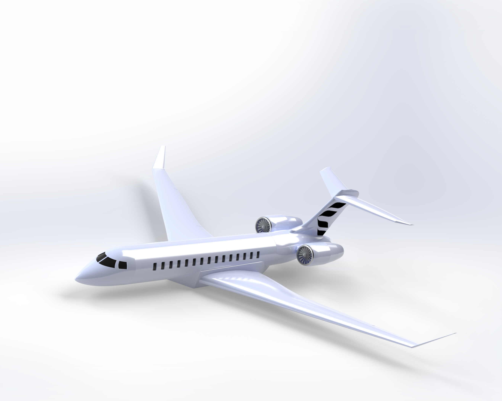

# Stephen Evuleocha | Mechanical & Aerospace Engineering

Selected projects in mechanical design, aerospace CAD, and engineering analysis.

## Bombardier Global 8000 CAD model

Personal aerospace CAD project. The SolidWorks model includes a lofted fuselage, wing and control-surface variants, the empennage, and GE Passport-inspired nacelle and fan geometry. The project documentation describes a fan-rotation motion study for visualization.

[Download the complete SolidWorks package](https://github.com/Nikechukwugrd/mechanical-aerospace-portfolio/releases/tag/global-8000-cad), extract the files together, and open the top-level assembly in SolidWorks. This is an educational representation. The supplied CAD archive includes a [CC0 license](global-8000/LICENSE).

## Electric-propulsion UAV and cave-mapping hardware

Research internship, McGill Aerospace Research, May–August 2024. Supported an electric-propulsion UAV using CAD, MATLAB/Simulink, PX4 and QGroundControl. Collaborated with ÉTS Lab INIT Robots on a Jetson Orin Nano ground station and prototyped waterproof packaging and internal layouts for a cave-mapping platform.

## Automotive engine geometry and inspection

[Concept study and reproducible calculations](engine-study/README.md). A newly prepared educational example in bore and stroke tradeoffs, piston speed, and dimensional nonconformance. The project uses assumed dimensions and synthetic measurements.
